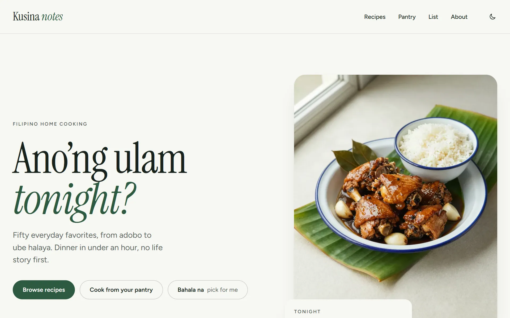
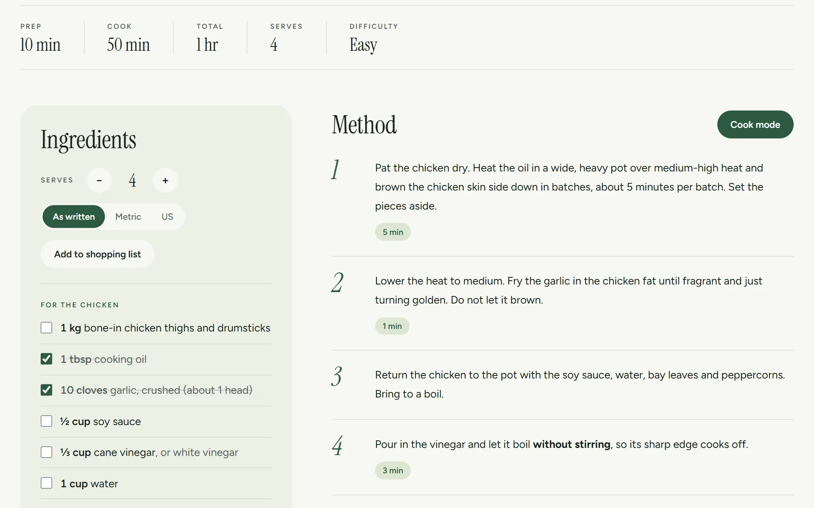
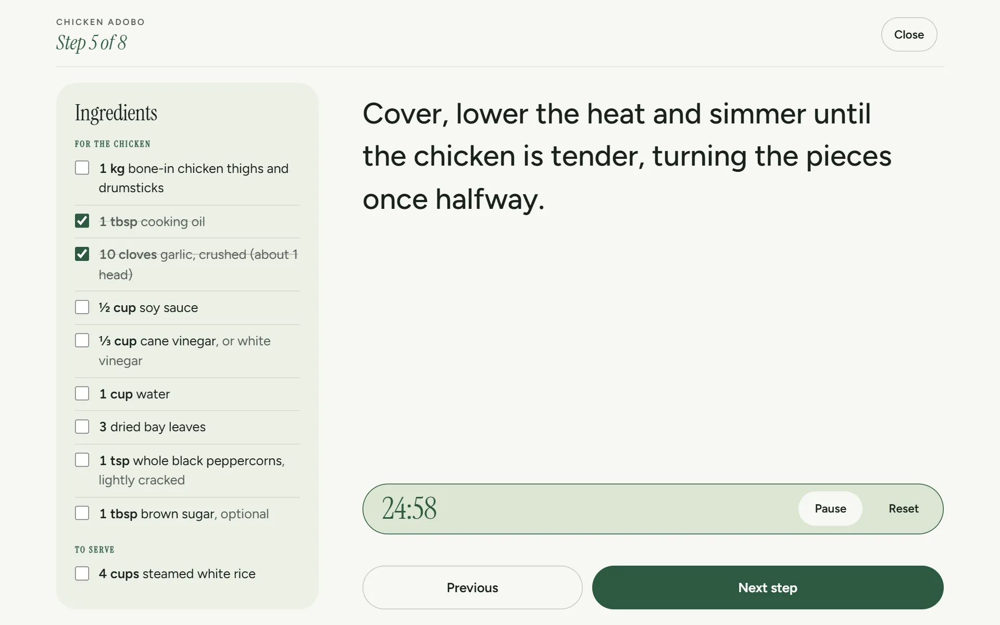
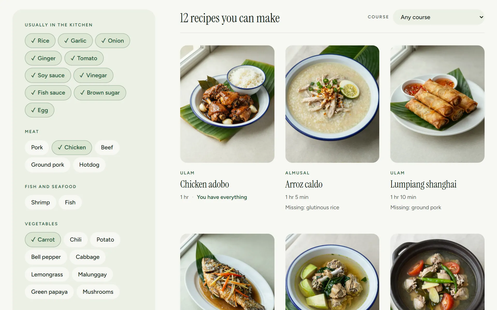
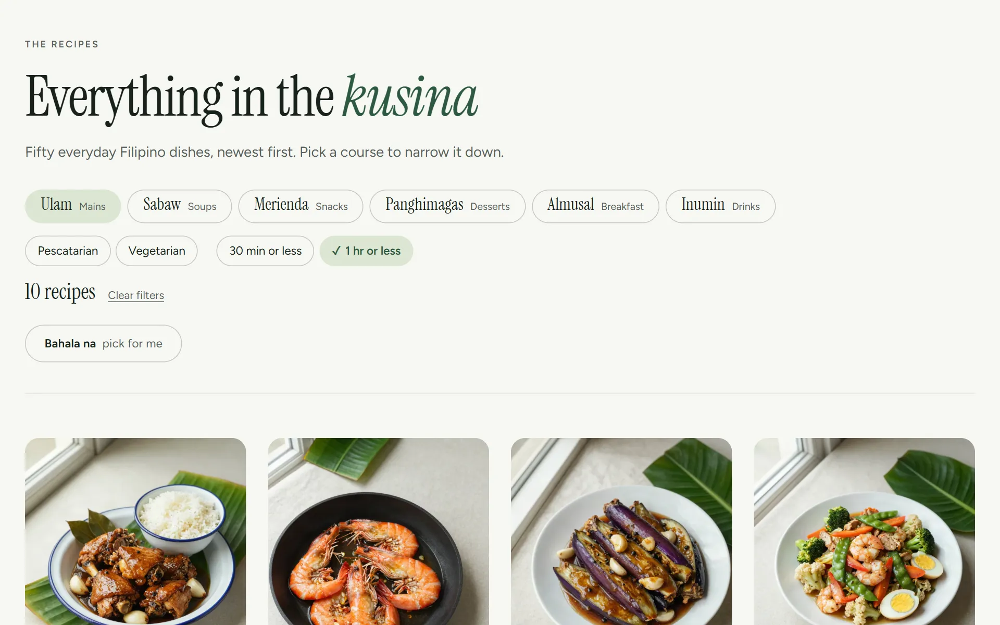

# Kusina Notes

A home-cooking recipe journal built on WordPress: Filipino everyday dishes and weeknight
staples, written to be cooked from, not scrolled past. No life stories above the recipe, no
pop-ups, no ads.

It is the third personal WordPress project alongside **jmcastillo-portfolio** and
**Terra & Thread Studio**, and shows a different skill set: content modelling, a custom
dynamic block, structured data for search, and interactive tools that keep working on a
static host.

**Live site:** https://kusina-notes.vercel.app

<picture>
  <source media="(prefers-color-scheme: dark)" srcset="docs/screenshot-home-dark.webp">
  
</picture>

<p>
  
  
</p>
<p>
  
  
</p>

## What a visitor can do

- **Scale a recipe**: change the servings and every quantity updates, shown as kitchen
  fractions (½, ⅓, ¾); switch between metric and US units.
- **Cook mode**: one step at a time, large type, the screen stays awake, and any step with a
  time gets a tap-to-start timer that chimes when done.
- **Pantry finder**: tick what is in the fridge and get recipes ranked by how few extra
  ingredients they need.
- **Filter the index** by course, diet and total time (30 minutes or less, under an hour).
- **Shopping list**: add recipes at their chosen servings; matching ingredients merge; the
  list lives in the browser and prints cleanly.
- **Print** any recipe on one page without the site chrome.

## Stack

- WordPress (block theme `kusina-notes` + plugin `kusina-core`) in Docker:
  `wordpress:php8.5-apache`, `mariadb:12.3`, `wordpress:cli-php8.5`.
- Vanilla JavaScript, no build step, no third-party scripts.
- Hosted as a static export on Vercel, like the other two projects.

## Run locally

```powershell
Copy-Item .env.example .env        # then set real passwords
docker compose up -d               # http://localhost:8092
docker compose run --rm cli wp core install --url=http://localhost:8092 --title="Kusina Notes" `
  --admin_user=admin --admin_password=<password> --admin_email=<email> --skip-email
docker compose run --rm cli wp theme activate kusina-notes
docker compose run --rm cli wp plugin activate kusina-core
docker compose run --rm cli wp rewrite structure '/%postname%/'
node scripts/validate-recipes.mjs  # check the recipe data
docker compose run --rm cli wp eval-file /scripts/seed-content.php --user=admin
```

## Status

Live at **https://kusina-notes.vercel.app** (a static export of the local WordPress; deploy
with `Deploy.cmd`). 50 recipes, each with an AI-generated photo, recipe card with
scaler, units, ingredient tick boxes and cook mode, recipe filters, "Bahala na" random
pick, pantry finder, shopping list, sharing tags (Open Graph, Twitter), and the "banana
leaf editorial" theme. Shown on the portfolio at
https://jmcastillo-portfolio.vercel.app/projects/kusina-notes/. Plan and
progress: [`docs/SPEC.md`](docs/SPEC.md); look and voice: [`docs/DESIGN.md`](docs/DESIGN.md).
